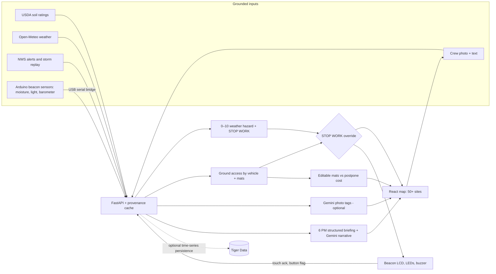

Readme · MD
# Groundwork — Utility Crew Ground-Access and Hazard Planning
 
> **SwampHacks XII · 36-hour hackathon · Team of 4**  
> **Pitch:** "By 6 PM, Groundwork tells utility crews which sites to prioritize tomorrow, which vehicles may need ground protection, when dangerous weather demands STOP WORK, and what delays could cost—using traceable weather and USDA soil data plus real crew reports."
 
**Document status:** Hackathon implementation plan, not certified safety guidance.  
**Last updated:** Oct 16, 2026 — project renamed **Groundwork** (formerly AccessCall 2.0). Rishi now owns the frontend and Aashita Rai the backend; Rishi joins backend work once the frontend is stable. Hardware plan revised to the team's confirmed kit: an **Arduino Uno "site beacon"** (Grove moisture, light, barometer, touch and button inputs; Grove LCD, red/green LEDs and buzzer outputs) connected to the laptop over USB. See §5. The demo playbook (kit, script, fallbacks, rehearsal) is in §14.  
**Team:** Anson (hardware), Rishi (frontend/product; joins backend work once the frontend is stable), Aashita Rai (backend/data), Rithika (ML/computer vision/briefing).  
**Repo:** https://github.com/anson-antony1/Groundwork  
**Source of sponsor requirements:** Team-provided Sperry Tech challenge description. Confirm exact language, submission requirements, and credits with the official challenge page/organizers.  
**Non-negotiable design rule:** A **weather hazard STOP WORK** override is different from a **ground-access vehicle recommendation**. Mats can help with some access conditions, but do **not** make lightning, flooding, or other severe hazards safe.
 
---
 
## 1. The problem in everyday terms
 
Before tomorrow's jobs, a utility supervisor needs to know:
 
1. Can the pickup or heavy truck reach a worksite without getting bogged down?
2. Are there heat, flood, storm, or lightning hazards that could make work unsafe?
3. If soft ground requires mats, roughly how many should the crew stage?
4. Is renting/hauling mats less expensive than postponing the job?
5. What did the crew actually encounter, and how should that change the plan?
Today those decisions may require juggling weather apps, soil maps, spreadsheets, and texts from workers. **Groundwork** puts them into one site map, with an explainable score, operational alerts, and a short evening briefing.
 
### 30-second description for judges
 
"Watch this tray. When we add water, the soil sensor changes the site's access reading—on the dashboard and on the site beacon's own screen. Switch the vehicle from pickup to heavy truck and its mat recommendation changes. Replay a storm and our weather safety engine overrides all access plans with STOP WORK: the beacon turns red and sounds an alarm until a crew member taps to acknowledge. A field worker uploads a hazard photo, which appears on the map. Behind the demo, we rank 50+ real geographic locations with timestamped weather and USDA soil records, and generate a 6 PM planning brief."
 
### Target users
 
- **Primary:** Utility field supervisors planning the next day's access and work.
- **Secondary:** Crew leads reporting hazards; operations managers assigning vehicles and staging ground mats.
- **Non-goal:** Independently certifying ground bearing capacity, approving vehicle operation, guaranteeing contract reimbursement, or replacing a safety officer.
---
 
## 2. Minimum product requirements and acceptance tests
 
The **Must** column is the team's launch contract. Demo mode is allowed, but **simulated values must be prominently labeled**.
 
| ID | Requirement | Implementation | Definition of done |
|---|---|---|---|
| P1 | ✅ **50+ real geographic sites** | Curated set of ≥50 distinct, valid coordinates and names, ideally actual public utility-access-relevant locations without claiming private company work orders | Map and ranked list show ≥50 site records; site coordinates are real, source of coordinates documented |
| P2 | ✅ **Real weather/soil inputs** | Open-Meteo forecast/history + USDA NRCS soil data; optional NWS alerts and FEMA/USGS indicators | Each site shows data origin, observed/forecast period, fetched-at timestamp, and any missing fields |
| P3 | ✅ **Hazard score (0–10)** | Rules-based weather risk composite with transparent sub-scores | Each site has score and explanation; missing data cannot silently become zero risk |
| P4 | ✅ **Lightning stop-work** | Active NWS thunderstorm-related warning/alert as conservative trigger; historical replay fallback. Strike-based radius/countdown only with verified licensed strike feed | Triggering alert displays prominent STOP WORK; no unsupported "30-minute all clear" claim |
| P5 | ✅ **Flooding** | NWS flood-related alerts + precipitation and optional water level/FEMA map context | Flood concern appears in score and safety state; FEMA flood zones are long-term susceptibility, not live flood detection |
| P6 | ✅ **Heat** | Forecast apparent temperature and/or properly calculated heat index with configurable policy | Heat concern displayed and linked to a recommended supervisor review/action; threshold is labeled as demo policy |
| P7 | ✅ **Vehicle-specific access** | Ground-wetness/soil indicators + pickup/heavy-truck sensitivity policy | Changing vehicle changes access call without changing meteorological hazard score |
| P8 | ✅ **Mat staging range** | Editable mat dimensions, effective coverage, route dimensions, layer policy, availability | UI shows range + calculation + units + engineering caveat |
| P9 | **Mats vs postpone cost** | User inputs for rental, handling, labor, hours, equipment | Recalculates live; labels assumed values and does not call savings guaranteed |
| P10 | **Crew hazard report** | Photo + text + GPS/site + timestamp; image tagging is advisory | Submitted report displays as map pin/feed item; report is distinguishable from verified official hazard alert |
| P11 | ✅ **6 PM briefing** | Deterministic aggregation → optional LLM narration | A manual Generate 6 PM Plan button creates ranked priority list and mentions data gaps; automated scheduler only if time permits |
| P12 | **Physical demo (site beacon)** | Arduino Uno reads the Grove moisture sensor (plus light and barometer once Tiers 2–3 work) and drives the Grove LCD, red/green LEDs and buzzer; a laptop serial bridge relays readings to the API and status back to the beacon (see §5) | Pouring water changes the actual sensor reading, reaches the UI, can change the demo access recommendation, and the beacon's LEDs/LCD reflect the server's status within ~2 s; recorded replay works when unplugged |
| P13 | ✅ **Incident replay** | Saved past-storm event data with source and timestamps | Replay triggers STOP WORK and restores original live/scenario state when exited |
| P14 | **Reliable end-to-end demonstration** | Dedicated two-minute scripted path and local fallbacks | Full demo works without external API access after initial data snapshot |
| P15 | **Crew acknowledgment** | Touch sensor on the beacon acknowledges a STOP WORK alarm; the event is logged with a timestamp | Buzzer stops and the dashboard shows "acknowledged at [time]" while status **stays** STOP_WORK |
 
**Stretch, not baseline:** PDF export, full role-based login, Capital One Nessie, text messaging via SMS vendor, live strike feed, production-scale deployment, validated soil bearing-capacity model, automated operational dispatch. **Gemini photo tags + 6 PM narration are the preferred MLH add-on; Tiger Data is conditional.**
 
---
 
## 3. Critical design: two distinct decisions
 
### A. Weather safety (all vehicles)
 
**Hazard score: 0–10** answers, "How hazardous will weather be?" It can include precipitation, wind, heat, flood alerts, and storm alerts.
 
`weather_state`: `NORMAL` / `CAUTION` / `STOP_WORK` / `UNKNOWN`
 
- Hard override on active applicable lightning/severe-thunderstorm/flood emergency rule as configured by the team's policy. Exact alert categories and applicability must be checked before claiming a specific stop-work rule is industry standard.
- The hazard score is explanatory; a hard override **cannot be averaged away** by good conditions in other categories.
- `UNKNOWN` means data is missing or stale; do not display as safe.
### B. Ground access (per vehicle)
 
`access_call`: `GO_FOR_REVIEW` / `MATS_FOR_REVIEW` / `NO_GO_FOR_REVIEW` / `UNKNOWN`
 
This is a **planning recommendation**, derived from soil drainage/texture, recent rain, modeled moisture, planned vehicle class, and user-provided route conditions. It is **not a soil-load engineering certification**.
 
**Effective operational status:**
 
```python
def effective_status(weather_state, access_call):
    if weather_state == "STOP_WORK":
        return "STOP_WORK"
    if weather_state == "UNKNOWN" or access_call == "UNKNOWN":
        return "SUPERVISOR_REVIEW"
    return access_call
```
 
**Example:** a pickup may be `GO_FOR_REVIEW` while a heavy utility truck is `MATS_FOR_REVIEW`. If a storm alert comes in, **both** become `STOP_WORK` even if mats are staged.
 
### Example hazard calculation (demo policy, not regulatory limits)
 
Start with documented policy-config weights; tune only with sponsor guidance, never silently:
 
```text
rain_risk:     0–10 derived from recent + forecast precipitation
wind_risk:     0–10 from forecast gusts
heat_risk:     0–10 from apparent temp/heat policy
flood_risk:    0–10 from flood alerts + contextual rainfall
storm_risk:    0–10 from NWS storm alerts
 
score = round(0.25*rain + 0.15*wind + 0.20*heat
            + 0.20*flood + 0.20*storm, 1)
```
 
Use this only as an **illustrative initial formula**, with scores calibrated by explicit `policies.json`. Active critical alert overrides score; if any mandatory field is absent return `data_quality=INCOMPLETE`, not `risk=0`.
 
---
 
## 4. Data sources: real, traceable, fail visibly
 
| Data | Preferred source | Real vs. forecast | Notes / fallback |
|---|---|---|---|
| Site latitude/longitude | Team-curated geocoded dataset | Real geographic coordinates | Document how 50+ locations were selected; **do not** imply these are actual Sperry customer sites |
| USDA soil map units, drainage, component texture | USDA NRCS Soil Data Access | Survey estimate | Spatial mapping/query may need point-to-map-unit join; verify schema, coverage and dominant component logic |
| Last 7 days of rainfall | Open-Meteo historical/forecast API as appropriate | Modeled/reanalysis; not a field rain gauge | Archive/recent windows and timezones matter |
| Next-day rain, gusts, apparent temperature | Open-Meteo Forecast | Forecast | Cache per site/time; handle per-provider units |
| Soil moisture | Open-Meteo model-based soil moisture if supported by selected model | Modeled estimate | **Do not** claim a direct soil-strength measurement |
| NWS alerts | NWS alerts API | Official active alert | Location relevance, time, event type; cache/replay old event separately |
| Flood hazard zones | FEMA National Flood Hazard Layer | Long-term mapped susceptibility | **Not current flood depth**; never describe as live flooding |
| Stream gauge (optional) | USGS Water Services | Observed gauge reading | Gauge must be meaningfully relevant to site's waterway |
| Tray soil moisture | Arduino beacon (Grove moisture sensor) | Observed local demonstration device | **Demo tray only**, not evidence for a remote site's field conditions |
| Beacon light level | Arduino beacon (Grove light sensor) | Observed at the demo table | Relative 0–100 index; advisory "low light" note on the demo site only |
| Beacon pressure/temperature | Arduino beacon (Grove barometer) | Observed at the venue | Station pressure, not sea-level adjusted; 3-hour pressure tendency is an advisory note only and **never** a STOP WORK trigger |
| Crew photos and notes | Submitted by team/user | Reported; unverified until reviewed | Show upload time and review status |
 
**Required metadata per value:**
 
```json
{
  "value": 24.7,
  "unit": "mm",
  "source": "Open-Meteo",
  "kind": "forecast",
  "valid_at": "2026-10-17T15:00:00-04:00",
  "fetched_at": "2026-10-16T18:00:00-04:00",
  "quality": "available",
  "reference_url": "https://open-meteo.com/"
}
```
 
`value` may be `null` when unavailable. Supported quality states: `available`, `stale`, `missing`, `simulated`, `sensor_demo`, `sensor_replay`.
 
**Caching:** ingest all sites into SQLite before demo; refresh in batches with bounded concurrency, cache TTL, rate limiting, per-site error logs, and backoff. Batch where provider supports it. For 50 sites, report **how many actually have USDA + weather data**, not just map pins.
 
**Suggested official references:**
 
- USDA Soil Data Access: https://sdmdataaccess.sc.egov.usda.gov/ and https://sdmdataaccess.sc.egov.usda.gov/WebServiceHelp.aspx
- Open-Meteo: https://open-meteo.com/en/docs and https://open-meteo.com/en/docs/historical-weather-api
- NWS alert API: https://www.weather.gov/documentation/services-web-api
- FEMA National Flood Hazard Layer: https://www.fema.gov/flood-maps/national-flood-hazard-layer
- USGS water services: https://waterservices.usgs.gov/
---
 
## 5. Physical hardware path (Anson): the Groundwork site beacon
 
The beacon is a small box beside the demo tray that **senses** (soil moisture, light, pressure/temperature), **shows** the server's decision (LCD, red/green LEDs, buzzer) and **accepts crew input** (touch to acknowledge, button to flag). **The Arduino never computes safety status**; it displays what the backend decides.
 
Why an Arduino Uno: it has built-in 10-bit analog inputs for the moisture and light sensors (a bare Raspberry Pi has none), and a USB serial link to the laptop means the physical demo does not depend on venue Wi-Fi.
 
### 5.1 Confirmed inventory (Oct 16)
 
| Item | Qty | Role in Groundwork |
|---|---:|---|
| Arduino Uno | 1 | Beacon controller: reads sensors, drives outputs, talks to the laptop over USB serial |
| Grove moisture sensor | 1 | Tray soil wetness → demo access call (**Tier 1**) |
| Grove touch sensor | 1 | Crew acknowledges a STOP WORK alarm (**Tier 1**) |
| Grove buzzer | 1 | STOP WORK alarm until acknowledged (**Tier 1**) |
| Red LED + green LED | 1 each | At-a-glance status (**Tier 1**) |
| Resistors | assorted | 220–330 Ω current limiters for the LEDs |
| Grove LCD RGB Backlight | 1 | 16×2 status text; backlight color = status (**Tier 2**) |
| Grove button | 1 | Short press: cycle LCD pages; long press: crew flag for supervisor review (**Tier 2**) |
| Grove temperature & barometer sensor | 1 | Continuous venue pressure/temperature log and pressure-tendency advisory (**Tier 3**) |
| Grove light sensor | 1 | Low-light advisory at the beacon (**Tier 3**) |
| Breadboard | 1 | Power rails, LEDs/resistors, shared I2C bus |
| Jumper wires | 6 M–M, 6 M–F + Arduino kit wires | Uno ↔ breadboard ↔ modules |
| Raspberry Pi | optional | Not required. If one is available, it can run `serial_bridge.py` beside the tray instead of the laptop |
 
**Still needed (first 30 minutes):** a **USB-B cable** for the Uno (plus a USB-C adapter if the laptop needs one), and a way to connect the Grove modules to the Uno (§5.3).
 
### 5.2 Scope tiers
 
- **Tier 1 (must, by hour 12):** moisture in; red/green LEDs and buzzer out; touch acknowledgment; two-way serial link. This alone delivers the core physical demo.
- **Tier 2 (should, by hour 18):** Grove LCD status screen with colored backlight; button page-cycle and crew flag.
- **Tier 3 (could, by hour 24):** barometer pressure/temperature logging and 3-hour pressure tendency; light-level advisory.
If a tier misbehaves at its gate, unplug it and keep the lower tiers stable.
 
### 5.3 Connecting Grove modules to the Uno
 
Grove modules use 4-pin Grove connectors, not breadboard pins. In order of preference:
 
1. **Grove Base Shield for Arduino** (ask the MLH hardware lab): stacks on the Uno; modules plug straight into labeled ports. Easiest and most reliable.
2. **Grove-to-jumper adapter cables** (Grove plug on one end, male or female pins on the other): one per module into the breadboard.
3. **Fallback — cut cables:** cut a Grove-to-Grove cable in half (the wire cutter and stripper stay at the MLH lab), strip ~5 mm, twist the strands, push them into the breadboard, and tape for strain relief. One cable gives two module leads.
**Grove color code:** yellow = signal (SCL on I2C modules) · white = second signal (SDA on I2C modules; unused on most single-signal modules) · red = VCC · black = GND.
 
### 5.4 Pin map (same for all three connection plans)
 
| Module | Signal type | Uno pin | Base Shield port |
|---|---|---|---|
| Moisture sensor | Analog in | A0 | A0 |
| Light sensor | Analog in | A2 | A2 |
| Touch sensor | Digital in | D2 | D2 |
| Button | Digital in | D4 | D4 |
| Buzzer | Digital out | D6 | D6 |
| Red LED (+220 Ω to GND) | Digital out | D8 | D8 port, yellow wire |
| Green LED (+220 Ω to GND) | Digital out | D9 | D8 port, white wire |
| Grove LCD RGB Backlight | I2C | A4 (SDA) / A5 (SCL) | any I2C port |
| Grove barometer | I2C | A4 / A5 (shared bus) | any I2C port |
| Power | — | 5V and GND to breadboard rails | built in |
 
Notes:
 
- Each Base Shield port also carries the next pin (port A0 = A0 + A1, port D8 = D8 + D9), so the map uses every other port to avoid collisions. One cut Grove cable on port D8 drives both LEDs.
- A4/A5 are the Uno's I2C pins, so they cannot double as analog inputs.
- The LCD and barometer share the I2C bus. Run an I2C scanner sketch first and confirm both devices appear.
- Power Grove modules from the Uno's 5V rail; check each module's wiki page for its supported voltage (the LCD in particular expects 5V).
### 5.5 Breadboard wiring
 
- Uno 5V → breadboard + rail; Uno GND → − rail.
- Each LED: Uno pin → 220 Ω resistor (red-red-brown) → LED long leg (anode); short leg (cathode) → GND rail.
- I2C: Uno A4 (SDA) and A5 (SCL) → two breadboard rows; both I2C modules' white (SDA) and yellow (SCL) leads join those rows.
- Jumper budget: about 11 Uno-to-breadboard jumpers (5V, GND, A0, A2, A4, A5, D2, D4, D6, D8, D9). The 6 M–M wires plus the Arduino kit wires cover this; keep the M–F wires for anything with male header pins (such as a Pi, if one appears).
- Keep the Uno and breadboard **in a box or raised off the table**, away from the tray. Only the moisture probe's prongs go into the soil.
### 5.6 What the beacon shows
 
The server decides status; the beacon only renders it.
 
| Server status | Serial code | LCD backlight | Red LED | Green LED | Buzzer |
|---|---|---|---|---|---|
| `GO_FOR_REVIEW` | `GO` | Green | Off | On | Off |
| `MATS_FOR_REVIEW` | `MATS` | Amber | On | On | Off |
| `SUPERVISOR_REVIEW` | `REVIEW` | Amber | On | On | Off |
| `NO_GO_FOR_REVIEW` | `NOGO` | Red | On | Off | Off |
| `STOP_WORK` | `STOP` | Red | Blinking | Off | Pulsing until touch-acknowledged |
| `UNKNOWN`, or no status line for 6 s | `UNKNOWN` / stale | White | Alternating blink | Alternating blink | Off |
 
Rules:
 
- **Green never appears on stale data.** If the Uno receives no status line for 6 seconds, it switches to `NO LINK` on its own.
- **Touch acknowledges; it does not clear.** Touching silences the buzzer immediately and sends an `ack_touch` event. STOP_WORK remains until the weather logic clears it, and a new STOP_WORK re-arms the alarm.
- **Button:** a short press cycles LCD pages (status → moisture/light → pressure/temperature); a long press (≥2 s) sends `crew_flag`, which puts the demo site in `SUPERVISOR_REVIEW` and adds a feed item. It never changes `weather_state`.
LCD text examples (16×2): `DEMO TRAY   HVY` / `MATS FOR REVIEW` · `DEMO TRAY` / `STOP WORK - ACK?` · `NO LINK` / `CHECK APP`.
 
### 5.7 Serial protocol (USB, 115200 baud, one line per message)
 
Arduino → laptop, every 1 s:
 
```json
{"type":"reading","seq":412,"uptime_ms":412003,"moisture_raw":678,"light_raw":402,"pressure_hpa":1012.84,"temp_c":24.6}
```
 
Arduino → laptop, on input:
 
```json
{"type":"event","seq":413,"event":"ack_touch"}
{"type":"event","seq":414,"event":"crew_flag"}
```
 
Omit fields for modules that are not connected; never send zeros in their place.
 
Laptop → Arduino, on any status change and as a heartbeat every 2 s:
 
```text
S|STOP|DEMO TRAY|STOP WORK - ACK?|1
```
 
Fields: code · LCD line 1 · LCD line 2 · alarm (1/0). The bridge trims text to 16 ASCII characters and strips `|`.
 
The Uno has no clock, so **the bridge stamps `recorded_at`** when each line arrives; `seq` and `uptime_ms` reveal dropped lines or board resets.
 
### 5.8 Bridge and API data contract
 
`hardware/serial_bridge.py` (pyserial + httpx) reads lines, validates them, applies calibration, posts to the API, polls the display state, and writes `S|...` lines back to the Uno.
 
```http
POST /api/v1/sensors/readings
Content-Type: application/json
Authorization: Bearer <sensor token>
```
 
```json
{
  "device_id": "tray-01",
  "site_id": "DEMO-TRAY",
  "seq": 412,
  "raw_adc": 678,
  "moisture_index": 73.4,
  "light_raw": 402,
  "light_index": 38.0,
  "pressure_hpa": 1012.84,
  "temp_c": 24.6,
  "calibration": "dry_wet_2point_v1",
  "recorded_at": "2026-10-16T21:00:00-04:00",
  "mode": "sensor_demo"
}
```
 
```http
POST /api/v1/devices/tray-01/events
```
 
```json
{"event": "ack_touch", "seq": 413, "recorded_at": "2026-10-16T21:00:04-04:00", "mode": "sensor_demo"}
```
 
```http
GET /api/v1/devices/tray-01/display
```
 
```json
{
  "device_id": "tray-01",
  "site_id": "DEMO-TRAY",
  "effective_status": "STOP_WORK",
  "code": "STOP",
  "lcd_line1": "DEMO TRAY",
  "lcd_line2": "STOP WORK - ACK?",
  "alarm": true,
  "acknowledged_at": null,
  "mode": "replay",
  "generated_at": "2026-10-16T21:00:03-04:00"
}
```
 
`moisture_index` and `light_index` are **sensor-calibrated 0–100 relative scales**, not volumetric water content or lux. `pressure_hpa` is station pressure (not sea-level adjusted), so do not compare it directly with numbers in a weather report. The bridge always sends raw values so the backend can recompute indexes if calibration changes. Running the bridge with `--replay fixtures/sensor_replay.csv` streams a recording with `mode: "sensor_replay"`, shown in the UI as **Recorded demo**. The dashboard can poll at 1–2 seconds (acceptable for MVP) or use a WebSocket if stable.
 
### 5.9 Calibration (Anson, hours 2–6)
 
- **Moisture:** take several readings in dry soil and in saturated soil; store both endpoints in `hardware/calibration.json`; map raw → 0–100 and clamp.
- **Light:** take readings with the sensor covered (dark) and under room or phone light (bright); same two-point mapping.
- **Barometer:** factory-calibrated; verify readings are plausible and stable. Start logging as soon as it works, so by demo time there is a real multi-hour record of the venue's pressure and temperature.
- **Touch/button:** confirm idle vs. active levels in the Serial Monitor; debounce in firmware (~30 ms); long-press threshold 2 s.
### 5.10 Kit checklist
 
- Arduino Uno, **USB-B cable** (and adapter), laptop with the Arduino IDE and libraries installed: Seeed's Grove LCD RGB Backlight library, plus the library matching the barometer's chip (check the board label: BMP180, BMP280 or BME280).
- Grove modules from §5.1, a connection method from §5.3, breadboard, resistors, jumpers.
- Two shallow trays, soil/sand, water bottle, towels, waterproof tray under electronics, zip ties/tape, a small box to raise the electronics.
- Laptop browser with Groundwork's Sensor Lab view; backup `sensor_replay.csv`; a short phone video of the beacon working.
- Keep electronics and mains power protected from spilled water.
### 5.11 Demo event behavior
 
```text
water poured -> moisture_raw rises -> bridge posts reading
-> backend recomputes DEMO-TRAY ground wetness proxy -> vehicle access call -> mat range
-> dashboard updates with timestamp + "Demo sensor" provenance
-> display endpoint changes -> bridge sends S|MATS|... -> LCD amber, both LEDs on
 
storm replay starts -> weather_state = STOP_WORK -> display code STOP, alarm 1
-> LCD red, red LED blinks, buzzer pulses
-> crew touches sensor -> ack_touch event -> buzzer silent, dashboard logs acknowledgment time
-> status remains STOP_WORK until the replay ends
```
 
### 5.12 Hardware gotchas
 
- Close the Arduino IDE Serial Monitor before running the bridge; only one program can hold the serial port.
- Opening the serial port resets the Uno, so the bridge waits ~2 s before sending.
- AVR `sprintf` does not format floats; print floats with `Serial.print(value, 2)` or `dtostrf`.
- Port names: macOS `/dev/cu.usbmodem*`, Linux `/dev/ttyACM0`, Windows `COM3` or similar.
- Resistive moisture probes corrode when powered in wet soil for long periods; rinse and dry the prongs between rehearsals.
- Label every wire with tape, and re-seat the Grove leads after moving the box.
**No fake field claim:** The tray and beacon represent how Groundwork would accept future in-ground field readings and push status to a site; they are not measurements from the 50 remote geographic sites. Beacon light and pressure readings are advisory notes on the demo site only and never trigger STOP WORK.
 
---
 
## 6. Mat and cost estimation (simple and transparent)
 
### Mat estimate
 
Inputs (editable in UI): route length `L`, route width `W`, effective coverage of each mat `M_l × M_w`, number of layers `k`, overlap/waste margin `m`, stock count, vehicle class. **No invented universal rental price or mat-load rating.**
 
A simple area method:
 
```text
base_mats = ceil((L * W) / (M_l * M_w))
planned_mats = ceil(base_mats * k * (1 + m))
min/max = apply user-edited layer and contingency range
shortfall = max(0, max_estimate - mats_in_inventory)
```
 
This ignores route bends, geotechnical engineering, true mat overlap geometry and mat capacity. It is an **early logistics estimate**, not a design calculation. Units must agree (ft or m). Allow the supervisor to override quantity with a reason.
 
### Decision economics
 
```text
mats_option = mats_rental + delivery + installation + removal + delay_not_prevented
postpone_option = paid_idle_labor + idle_equipment + rescheduling + extra_contract_cost
modeled_difference = postpone_option - mats_option
```
 
Display **"Illustrative estimate — edit assumptions"** near price results. Never recommend mats when weather state is `STOP_WORK`; instead show the financial comparison as a planning scenario only.
 
Example with explicitly illustrative amounts:
 
| Input | Example | Real implementation |
|---|---:|---|
| Mats rental + logistics | $900 | Supervisor enters vendor quote |
| Postpone cost | $2,800 | Supervisor enters crew/equipment assumptions |
| Modeled cost difference | $1,900 | Computed; **not guaranteed savings** |
 
---
 
## 7. Photo + text crew hazard reports (Rishi + Rithika)
 
**Crew flow:** Open site → tap Report Hazard → optional photo + required short description → category and severity → send → map pin appears.
 
Suggested categories: `mud`, `standing_water`, `flooded_road`, `fallen_tree`, `overhead_hazard`, `lightning_observed`, `heat`, `other`.
 
**Rithika's CV:** deliver an advisory tag such as `standing_water`, `mud`, or `fallen_tree`. The tag must be labeled **"AI suggested · needs human review"** with an easy user correction control. For hackathon reliability, use a small pre-trained image classifier or zero-shot vision service, compare on a handful of honestly labeled sample photos, and fall back to manual category selection. Do **not** train a new image model unless a reliable dataset is ready.
 
**Reporting vs safety:** A photo's AI tag alone must not certify danger or clearance. Crew reports can flag `SUPERVISOR_REVIEW`; only validated alert/policy logic drives automatic weather STOP WORK in the demo.
 
Report example:
 
```json
{
  "id": "report-001",
  "site_id": "SITE-012",
  "description": "Standing water near the southern gate",
  "category_user": "standing_water",
  "category_ai": "standing_water",
  "ai_confidence": 0.79,
  "image_path": "/uploads/report-001.jpg",
  "reported_at": "2026-10-16T20:45:00-04:00",
  "verification": "unreviewed"
}
```
 
Do not use exact private field-crew positions or personally identifying data unless consent and need are established. Keep local upload storage for the hackathon.
 
---
 
## 8. Rithika's ML + intelligence workstream
 
### Must-have: smart but auditable explanation layer
 
1. Consume the structured forecast, site score, vehicle decision, mat range, costs, provenance, and crew reports.
2. Generate a ranked **6 PM plan** with deterministic Python priority sorting. LLM only explains and summarizes; **never** asks model to invent scores, prices, or mat counts.
3. Optional image tagger on hazard photos, with explicit review label.
4. Show a small "Why this call?" panel: weather trigger(s), soil drainage rating, vehicle class, and missing fields.
**LLM prompt contract:**
 
```text
SYSTEM: You are a utility-work planning briefing writer.
Use only the provided structured facts. Do not invent numbers,
claims of field measurements, clearance approvals, or weather alerts.
Preserve STOP_WORK override. Note unknown/stale values.
Return concise JSON: summary, top_priority_sites, safety_alerts,
mat_staging, missing_data_notes, and crew_report_followups.
```
 
Use Pydantic/schema validation on the response, then verify numbers and site IDs against backend truth. Fallback: deterministic template generation if Gemini/API network fails.
 
### Optional ML — only if baseline system is complete
 
- **Never** train a model to reproduce Open-Meteo's already-available soil-moisture forecast and call that novel.
- Possible research prototype: predict storm-related operational disruptions using *historical storm labels* (carefully define labels, geographical alignment, forecast-only features and time-based holdout) and compare against the rules engine.
- More aligned **future** model: learn from adequately labeled, representative crew outcomes (`access_success`, `stuck`, `mats_used`) once enough records exist.
- Never claim the prototype predicts real soil bearing capacity or truck-stuck probability without ground truth.
**Measured evaluation for photo tagging:** small held-out labeled examples; show per-class accuracy or confusion matrix if sample size supports it, otherwise clearly say qualitative demonstration.
 
---
 
## 9. Product UI and screens (Rishi)
 
### Screen 1 — Operations map (home)
 
- Full map (React Leaflet/OpenStreetMap) showing ≥50 sites; status color + filter; list with site name, weather score 0–10, effective status, data completeness, last refreshed time.
- Top statistics: total sites, STOP WORK, need mats review, data-missing count.
- Distinct markers or visual labels for `LIVE/CACHED`, `REPLAY`, `SIMULATED`, `SENSOR DEMO`.
- Ranked list: critical alerts first, then high hazard score, then access restriction, then missing-data review.
### Screen 2 — Site detail
 
- Site name, coordinates, actual soil survey rating + source, forecast (rain, heat, storm/flood context).
- **Weather hazard score** (0–10) and **access call** (per vehicle) in separate cards.
- Vehicle toggle: `Pickup` ↔ `Heavy truck` (policy simulation, not certified weight-bearing decision).
- Editable route/mat fields; range and methodology; existing stock and shortfall.
- Cost option cards: mats vs postpone with editable assumptions.
- Photo/text hazard report button and chronological event log.
### Screen 3 — Sensor lab
 
- Live beacon readings (moisture index, light index, pressure, temperature), calibration state, time of latest update, link status, demo-mode label.
- **Beacon mirror:** what the LCD and LEDs are showing right now, so judges at the back of the room can see it.
- Acknowledgment and crew-flag log with timestamps.
- Pressure history chart with 3-hour tendency once Tier 3 works.
- "Pour water" physical demonstration followed by visual access-state change.
- One-click replay from pre-recorded CSV if the beacon fails.
### Screen 4 — Storm replay
 
- Historical event selector, timestamps, source, playback speed.
- Timeline crosses applicable storm-alert boundary → `STOP_WORK` overlay for all vehicles.
- Exiting replay restores the current live/cached snapshot; don't blend contexts.
### Screen 5 — 6 PM briefing
 
- Ranked sites, weather stoppages, mat-staging estimates, vehicle-specific notes, unresolved photo reports, data gaps and sources.
- Generate on demand for demo; only add automated 6 PM scheduling if low-risk and time permits.
**Visual principle:** demonstrate a *change*: sensor rises → access changes on screen and on the beacon; vehicle switches → mat recommendation changes; warning arrives → STOP WORK and the beacon alarm sounds; report uploads → map pin appears.
 
---
 
## 10. Architecture and interfaces
 
```text
              USDA Soil Data Access ------\
              Open-Meteo ------------------+--> Python ingestion/cache --\
              NWS alerts -----------------/                           |
              FEMA/USGS (optional) -------/                           |
                                                                       v
 Arduino Uno beacon <--USB serial--> serial_bridge.py <--HTTP--> FastAPI ---> SQLite
 (sensors in; LCD/LEDs/buzzer out)                                  |            |
 Field photo + text ------------------------> FastAPI upload -------+            |
                                                                     v            v
                                                   Rules / access / mats / costs
                                                                     |
                                                                     +--> display state --> beacon
                                                                     +--> Briefing JSON + optional Gemini narration
                                                                     |
                                                                     v
                                                            React / Leaflet dashboard
```
 
**Recommended stack:** React + TypeScript + Vite + Tailwind + React Leaflet; FastAPI + Pydantic + HTTPX + SQLAlchemy/SQLite (optional Tiger Data PostgreSQL adapter); Arduino C++ firmware (Wire, Seeed Grove LCD RGB Backlight library, barometer library); Python `pyserial` bridge; optional `scikit-learn`, `transformers`/vision API, Gemini; local disk for uploaded photos. Deploy backend/frontend only if stable; a local network demo is acceptable if judge connectivity is unreliable.
 
### API contract (Aashita owns backend integration)
 
| Method | Endpoint | Purpose |
|---|---|---|
| GET | `/api/v1/health` | Service and data-source status |
| GET | `/api/v1/sites` | 50+ sites with summary, filters |
| GET | `/api/v1/sites/{id}` | Site detail, provenance, hazard and access status |
| POST | `/api/v1/sites/{id}/evaluate` | Vehicle, route, mat assumptions → access + financial comparison |
| POST | `/api/v1/sensors/readings` | Ingest beacon readings; requires simple secret/token |
| GET | `/api/v1/sensors/{device_id}/latest` | Poll current sensor values |
| GET | `/api/v1/sensors/{device_id}/history` | Recent beacon readings for Sensor Lab charts and pressure tendency |
| GET | `/api/v1/devices/{device_id}/display` | Status code, LCD text and alarm flag for the beacon |
| POST | `/api/v1/devices/{device_id}/events` | Beacon events (`ack_touch`, `crew_flag`); requires sensor token |
| POST | `/api/v1/reports` | Multipart photo/text upload and metadata |
| GET | `/api/v1/reports` | Site report list/map pins |
| GET | `/api/v1/events` | Site timeline, current alerts |
| POST | `/api/v1/replay/start` | Switch to historical scenario |
| POST | `/api/v1/replay/stop` | Restore current scenario |
| POST | `/api/v1/briefings/generate` | Deterministic brief + optional AI narration |
| GET | `/api/v1/policies` | Read labeled demo thresholds and model assumptions |
| POST | `/api/v1/demo/reset` | Demo only: end any replay, clear demo-session reports and beacon acknowledgments, re-arm the beacon; requires sensor token |
 
**Integration shape:** all endpoints return `{data, mode, generated_at, sources, missing_fields, errors}` as relevant. Define shared types in `shared/contracts.ts` or `openapi.json`; front and backend should test against one common fixture.
 
### Main relational tables
 
```sql
CREATE TABLE sites (
  id TEXT PRIMARY KEY, name TEXT NOT NULL,
  latitude REAL NOT NULL, longitude REAL NOT NULL,
  region TEXT, location_origin TEXT NOT NULL
);
CREATE TABLE observations (
  id INTEGER PRIMARY KEY, site_id TEXT NOT NULL,
  variable TEXT NOT NULL, value REAL, unit TEXT,
  source TEXT NOT NULL, kind TEXT NOT NULL,
  valid_at TEXT, fetched_at TEXT NOT NULL,
  quality TEXT NOT NULL, reference_url TEXT,
  FOREIGN KEY(site_id) REFERENCES sites(id)
);
CREATE TABLE site_snapshots (
  site_id TEXT PRIMARY KEY, hazard_score REAL,
  weather_state TEXT NOT NULL, access_pickup TEXT,
  access_heavy TEXT, reasons_json TEXT, missing_json TEXT,
  evaluated_at TEXT NOT NULL,
  FOREIGN KEY(site_id) REFERENCES sites(id)
);
CREATE TABLE sensor_readings (
  id INTEGER PRIMARY KEY, device_id TEXT, site_id TEXT,
  seq INTEGER, raw_adc REAL, moisture_index REAL,
  light_raw REAL, light_index REAL,
  pressure_hpa REAL, temp_c REAL,
  calibration TEXT, recorded_at TEXT, mode TEXT
);
CREATE TABLE device_events (
  id INTEGER PRIMARY KEY, device_id TEXT NOT NULL,
  site_id TEXT, event TEXT NOT NULL,
  seq INTEGER, status_at_event TEXT,
  recorded_at TEXT NOT NULL, mode TEXT
);
CREATE TABLE hazard_reports (
  id TEXT PRIMARY KEY, site_id TEXT NOT NULL,
  description TEXT NOT NULL, category_user TEXT,
  category_ai TEXT, ai_confidence REAL,
  image_path TEXT, reported_at TEXT NOT NULL,
  verification TEXT NOT NULL,
  FOREIGN KEY(site_id) REFERENCES sites(id)
);
CREATE TABLE briefing_runs (
  id TEXT PRIMARY KEY, generated_at TEXT NOT NULL,
  snapshot_json TEXT NOT NULL, narrative TEXT NOT NULL,
  mode TEXT NOT NULL
);
```
 
**Security minimum:** validate coordinates, units, and enum values; cap photo size (e.g., 5 MB) and accept only validated JPEG/PNG; sanitize names; never expose API keys in Vite; require a lightweight token for sensor ingestion and device events; send the beacon only sanitized 16-character ASCII LCD text; avoid storing real personal information.
 
---
 
## 11. Four-person assignment and boundaries
 
| Person | Primary ownership | Deliverables | Must integrate with |
|---|---|---|---|
| **Anson** | **Hardware + physical demo** | Arduino Uno beacon: Grove connection plan and pin map; firmware (sensors, LCD, LEDs, buzzer, touch, button); calibration; `serial_bridge.py`; dry/wet tray; replay CSV; waterproof, strain-relieved physical setup | Aashita's sensor, display and event endpoints + Rishi's Sensor Lab |
| **Aashita** | **Backend + data + core decision engine** | FastAPI; 50-site seed; USDA/Open-Meteo/NWS connectors; SQLite/provenance; 0–10 rules; STOP WORK precedence; vehicle and mat/cost calculation; beacon display state and event handling; all routes | All three teammates |
| **Rishi** | **Frontend + crew-report workflow** | React site map; site detail and vehicle toggle; mat/cost controls; Sensor Lab with beacon mirror and acknowledgment log; image/text upload UI; report pins; alert/replay/briefing screens; **once the frontend is stable:** backend tasks Aashita assigns (integration tests, endpoint wiring, data snapshot) | Aashita endpoint contracts; Rithika photo/briefing results |
| **Rithika** | **ML/CV + AI briefing** | Photo tagger (pretrained or API) with confidence/manual override; evaluation samples; data-grounded 6 PM narrative; deterministic narrative fallback; "why" explanations and data-gap wording; optional meaningful ML experiment only after MVP | Aashita's structured site/report data; Rishi's photo/briefing UI |
 
### Ownership rules
 
- Aashita owns **safety logic and numeric calculations**, not the LLM. Rithika can propose improvements but doesn't let AI set official statuses.
- Anson owns **firmware and the serial bridge**; Aashita owns the ingest, display and event endpoints **and the status logic the beacon displays**. Firmware never computes safety status.
- Rishi owns **client-side photo upload**, Rithika owns **advisory image tagging**, Aashita owns file storage route.
- Rithika owns **briefing text**, Aashita owns **briefing inputs and ranking data**.
- **Rishi joins the backend once the frontend is stable** (target: hour 24). Aashita assigns the tasks—integration tests, endpoint wiring, the frozen data snapshot—and remains owner of safety logic and shared contracts; Rishi's backend changes go through her review.
- **Integration captain:** Aashita maintains shared JSON contracts and green health endpoint; **demo captain:** Rishi handles the click path, Anson handles the physical tray and beacon, Rithika narrates the AI/briefing and fallbacks. Speaking order, lines and the reset routine are in §14.
### Shared handoff fixtures (implement in first 2 hours)
 
- `fixtures/sites_50.json` with known locations, explicitly marked `data_status` until fetched.
- `fixtures/site_detail.json` showing complete `hazard_score`, `weather_state`, `access_call`, `mats_estimate`, `sources` and `missing_fields`.
- `fixtures/report_example.json`, one photo for image tagger.
- `fixtures/storm_replay.json` with real source/event timestamps.
- `fixtures/sensor_replay.csv` containing recorded or explicitly simulated readings (`moisture_raw`, `light_raw`, `pressure_hpa`, `temp_c`) with timestamps.
- `fixtures/display_states.json` with one display payload per status, so firmware can be tested before the backend exists.
---
 
## 12. Suggested repo layout
 
```text
groundwork/
├── README.md
├── .env.example
├── docker-compose.yml                 # optional
├── backend/
│   ├── requirements.txt
│   ├── app/main.py
│   ├── app/api/{sites,sensors,devices,reports,replay,briefing}.py
│   ├── app/services/{weather,usda,nws,scoring,access,mats,cost,display}.py
│   ├── app/db/{models,seed}.py
│   ├── app/ai/{photo_tagger,briefing}.py
│   └── tests/{test_scoring,test_overrides,test_costs,test_display,test_api}.py
├── frontend/
│   ├── package.json
│   └── src/{App.tsx,components,pages,api,types}/
├── firmware/
│   ├── groundwork_beacon/groundwork_beacon.ino
│   └── i2c_scan/i2c_scan.ino
├── hardware/
│   ├── serial_bridge.py
│   ├── calibration.json
│   ├── calibration.md
│   └── wiring.md                      # pin map + photos of the build
├── fixtures/
│   ├── sites_50.json
│   ├── site_detail.json
│   ├── storm_replay.json
│   ├── sensor_replay.csv
│   └── display_states.json
├── policies/
│   ├── demo_thresholds.json
│   └── mats_defaults.json
└── docs/
    ├── demo_script.md
    ├── source_provenance.md
    └── real_vs_simulated.md
```
 
### Minimal developer setup (after files exist)
 
```bash
# backend
python -m venv .venv
source .venv/bin/activate
pip install fastapi uvicorn httpx sqlalchemy pydantic python-multipart pyserial
uvicorn backend.app.main:app --reload --port 8000
 
# frontend (separate terminal)
cd frontend
npm install
npm run dev
 
# beacon bridge (separate terminal, after flashing firmware/groundwork_beacon)
python hardware/serial_bridge.py --port /dev/cu.usbmodem1101 --api http://localhost:8000 --device tray-01
 
# no hardware? stream the recording instead
python hardware/serial_bridge.py --replay fixtures/sensor_replay.csv --api http://localhost:8000 --device tray-01
```
 
Use `VITE_API_BASE_URL=http://localhost:8000` locally; configure FastAPI CORS for the actual frontend origin. The beacon talks to the laptop over USB, so it does not depend on venue Wi-Fi. If a Raspberry Pi runs the bridge instead, point it at the laptop's LAN IP address, **not** `localhost`.
 
---
 
## 13. Build schedule: 36 hours, in parallel
 
| Phase | Anson — hardware | Aashita — backend/data | Rishi — UI | Rithika — ML/briefing |
|---|---|---|---|---|
| **0–2 h** | Settle Grove connection plan (shield/adapters/cut cables) and USB-B cable; blink test; I2C scanner finds LCD + barometer | Scaffold API, data contracts, initial 50-site coordinates | Scaffold React/Leaflet, site list with fixtures | Choose CV approach, define briefing JSON contract |
| **2–6 h** | Moisture, touch, LEDs, buzzer working; raw values in Serial Monitor; dry/wet calibration | Weather and USDA connectors, provenance records | Map and site detail with fixtures | Implement deterministic 6 PM plan draft + image upload tagging stub |
| **6–12 h** | Serial protocol + `serial_bridge.py` posting readings; status lines drive LEDs/buzzer; touch acknowledgment (**Tier 1 done**) | Hazard score, hard overrides, vehicle policy; sensor ingest + display + event endpoints | Sensor chart, toggle, status cards, cost UI | Working image tagger, manual override, brief template |
| **12–18 h** | LCD status screen + button (**Tier 2**); full tray → backend → UI → beacon test | Mat calculator, cost calculator, cached 50-site endpoints | Working report upload and map pins; beacon mirror + acknowledgment log | Connect photo API and briefing data; build test gallery |
| **18–24 h** | Barometer/light logging (**Tier 3**); stale-link mode; strain relief, labels, waterproofing; record replay CSV | NWS alert replay, cache/retry, missing fields, pressure tendency | Storm replay UI, briefing page | Grounded LLM narration optional, no hallucinated values |
| **24–30 h** | Demo setup and repeated trials; measure latency | Integration tests, source coverage dashboard | End-to-end happy path polish; then pair with Aashita on integration tests and backend fixes | Verify explanations, evaluation summary, evidence labeling |
| **30–34 h** | Hardware run-through + recorded backup video | Snapshot real data, freeze APIs | Lead two-minute demo rehearsal | Lock final briefing examples and demo narration |
| **34–36 h** | Buffer | Bug fixes only | Video/screenshots/submission | Q&A talking points; actual vs simulated slide |
 
**Hard scope gates:** At hour 6, if the Grove modules still can't connect to the Uno, switch to cut-cable leads immediately. At hour 12, if USDA cannot be queried reliably, preload an attributed USDA snapshot and visibly mark its age; do not invent soil data. Also at hour 12, Tier 1 hardware must work end to end; if it doesn't, freeze Tiers 2–3 and pull a teammate in to help. At hour 18, if photo CV is unstable, keep user-selected tag + upload and mark AI tag "unavailable"; if the LCD or barometer is flaky on I2C, unplug it—LEDs, buzzer and touch carry the demo. At hour 24, freeze optional ML/LLM features and ensure the deterministic briefing works. At hour 30, stop feature work.
 
---
 
## 14. Demo playbook: what we need, what we say, how we run it
 
> **Demo mode must be clearly displayed at the top of the dashboard.** Everything here assumes a judge walks up to our table with no context. Answers to likely questions are in §16.
 
### 14.1 What we need at the table
 
**Hardware**
 
- Arduino beacon, assembled in its box, every wire labeled, LCD facing the judges.
- USB-B cable plus a spare, and any laptop adapter.
- Two trays of soil: a **dry tray** (the starting point) and a **wet tray** (where the probe goes after each demo). Moving the probe between them resets the demo in seconds.
- A small cup with a **pre-measured amount of water** that reliably flips the reading to MATS in rehearsal. Mark the fill line on the cup.
- A plastic tub under the trays, paper towels, a towel, tape, two spare Grove leads, spare jumpers.
**Screens and devices**
 
- Rishi's laptop running the dashboard, mirrored to an **external monitor facing the judges** if we can get one.
- Aashita's laptop with backend logs and `/api/v1/health` open, turned away from the judges.
- One phone with the crew report form open and a **standing-water photo already in the camera roll**.
- Power strip, all chargers, and a phone hotspot in case venue Wi-Fi fails.
**Software state (check before every demo)**
 
- Backend running locally with the frozen data snapshot (50+ sites) and the storm replay loaded.
- Serial bridge running; the beacon shows green `GO` on the dry tray.
- Browser tabs open in order: Operations map → DEMO-TRAY site detail → Sensor Lab → 6 PM briefing. Zoom set so someone standing two steps back can read it.
- A 6 PM briefing already generated once, so the cached deterministic version is ready if Gemini is slow.
- Do Not Disturb on, screen sleep off, other apps closed.
**Backups**
 
- Recorded demo video on the laptop desktop and on a phone.
- `fixtures/sensor_replay.csv` ready for `serial_bridge.py --replay`.
- A QR code card linking to the GitHub repo and the Devpost page.
- Optional printout: the system diagram (§20) and the real-vs-simulated table (§15).
### 14.2 Table layout and roles
 
| Person | Stands | Job during the demo |
|---|---|---|
| **Rishi** | Behind the main laptop | Demo captain: opens, drives every click, hands off, closes |
| **Anson** | Beside the tray and beacon | Pours the water, guides the judge's tap on the beacon, fixes hardware |
| **Aashita** | At the backend laptop | Explains the safety override, watches logs, switches to fallbacks if anything stalls |
| **Rithika** | Front of the table, holding the phone | Sends the crew photo report, explains the AI tag and the 6 PM briefing |
 
Put the tray and beacon closest to the judges so they can touch them. Keep the electronics raised and away from the water.
 
### 14.3 Reset between judge groups (about 60 seconds)
 
1. **Rishi** clicks **Reset demo**, a hidden button that calls `POST /api/v1/demo/reset` (ends any replay, clears demo-session reports and acknowledgments) and sets the vehicle back to Pickup.
2. **Anson** moves the probe back into the dry tray, wipes the prongs, and refills the cup to the line.
3. Confirm the beacon shows green `GO` and DEMO-TRAY shows `GO_FOR_REVIEW` on the dashboard.
4. **Rishi** returns to the Operations map tab; **Rithika** opens a fresh report form on the phone.
5. **Aashita** confirms the health endpoint is green and the bridge shows no errors.
### 14.4 The two-minute script
 
Lines in quotes are what to say. Adapt the wording naturally, but keep the order and the timing. Replace bracketed values with real ones once they exist.
 
| Time | Who | Do | Say |
|---|---|---|---|
| **0:00–0:10** | Rishi | Operations map on screen | "It's 6 PM. A utility supervisor has [N] job sites tomorrow, a week of rain behind them and storms in the forecast. Groundwork turns all of that into one plan for tomorrow." |
| **0:10–0:30** | Anson | Pours the measured cup into the dry tray, then points at the beacon | "This is our site beacon. Watch the soil sensor as I water the tray. The reading climbs, our server re-scores the site, and the beacon turns amber: mats for review." |
| **0:30–0:55** | Rishi | Hands the judge the mouse to switch Pickup → Heavy truck, then scrolls to the cost cards | "Go ahead and switch it to a heavy truck. Same ground, different vehicle: the pickup is fine, but the heavy truck needs roughly [X–Y] mats. Here's mats versus postponing the job. Every cost is editable, because these are planning assumptions, not quotes." |
| **0:55–1:25** | Aashita (Anson guides the tap) | Starts the storm replay; the beacon turns red and the buzzer sounds; Anson invites the judge to tap the beacon | "Now a real storm: this is real weather data from Hurricane Milton, October 2024, replayed. The warning itself is simulated, because past alerts aren't available. Even with mats staged, every vehicle goes to STOP WORK. Safety always overrides access, and it can't be averaged away. Go ahead and tap the beacon. That records that the crew saw the alarm, but it doesn't clear STOP WORK. Only the weather logic can." |
| **1:25–1:45** | Rithika | Submits the standing-water report from the phone; the pin appears on screen | "A crew member reports standing water at the gate, and it lands on the map instantly. It's marked unverified until a supervisor reviews it. AI never sets a site's status." |
| **1:45–2:00** | Rithika, then Rishi | Opens the 6 PM briefing, then zooms out to all sites | **Rithika:** "At 6 PM, here's tomorrow's plan: [N] real sites ranked, every number traced to USDA, Open-Meteo or the Weather Service with a timestamp, and the data gaps called out." **Rishi:** "That's Groundwork. Happy to go deeper on anything." |
 
**Delivery rules**
 
- Talk to the judges, not the screen. Point at physical things.
- Let the judge touch something twice: the vehicle toggle and the beacon. People remember what they did themselves.
- Say the honest label as you go ("planning assumptions," "replayed," "needs review"). It builds trust and heads off the hardest questions.
- Hand off by name ("Aashita, show them a storm") so transitions feel planned.
- Stop at 2:00 and invite questions. Don't fill silence with extra features.
### 14.5 Shorter and longer versions
 
**30-second version** (busy judge or a passer-by): Rishi's opening line → Anson pours and the beacon turns amber → Aashita triggers STOP WORK and the beacon alarms → Rishi: "Fifty real sites, real weather and soil data, and a plan every evening at 6. Want the full two minutes?"
 
**Five-minute deep dive** (Sperry, AI-track and hardware judges often have time and want depth). After the two-minute script, pick what fits the judge:
 
- **"Why this call?" panel:** open a real site and walk through the trigger, soil drainage rating, vehicle class and missing fields.
- **Data coverage:** how many sites have USDA data, weather, both, or gaps, and how fresh each source is.
- **Safety tests:** show the passing tests for the STOP WORK override and "missing data never means safe."
- **AI grounding:** the Gemini prompt contract, schema validation, the number check against backend data, and the deterministic fallback working with Gemini switched off.
- **Photo-tag evaluation:** the labeled sample results, including the ones it got wrong.
- **Hardware integrity:** unplug the USB cable live. Within 6 seconds the beacon shows `NO LINK` and never shows green; plug it back in and it recovers.
- **Time series:** the beacon's pressure and temperature log over the whole event (from Tiger Data, if integrated).
- **Code:** the GitHub README and repo structure, if the judge asks.
### 14.6 Tailoring by judge
 
| Judge | Lead with | Make sure they see |
|---|---|---|
| **Sperry Tech** | Their own scenario: a remote site, heat climbing, storms building, ground soaked after a week of rain | Every line of their brief: site locations, continuously pulled conditions, crew alerts the moment conditions turn dangerous, and the hazard scoring/forecast (plus the ML backtest, if built) |
| **Hardware track** | The beacon | The sensor → server → beacon loop, touch acknowledgment, stale-link `NO LINK` behavior, calibration |
| **AI track / Gemini** | What AI does and doesn't do | Grounded briefing with validation and fallback, photo tags with human review, evaluation numbers, a clean repo |
| **Tiger Data** | The sensor and pressure history | A real time-series query and chart from stored rows |
| **Easy On The Eyes** | The map and site detail | Clear status colors, labeled data provenance, the beacon mirror |
| **General / Overall** | The supervisor's 6 PM problem | The full two-minute script with minimal jargon |
 
### 14.7 When something breaks
 
Stay calm, say one honest sentence, switch to the fallback, and keep going.
 
| Failure | Fallback | Say |
|---|---|---|
| Arduino or USB link fails | Aashita restarts the bridge with `--replay fixtures/sensor_replay.csv`; the screen shows `Recorded demo`, and the dashboard's beacon mirror still shows status | "Our USB link just dropped, so here's the same sequence we recorded earlier. It's labeled Recorded up top." |
| Moisture doesn't cross the threshold | Pour a little more; if it's still stuck, move the probe to the wet tray | "Real soil takes a moment to soak through." |
| LCD or barometer fails (I2C) | Unplug it; LEDs, buzzer and touch still carry the demo | "The screen's taking a break; the lights and alarm show the same status." |
| Loose Grove lead | Pre-labeled spare leads + tape; re-seat and rerun the I2C scanner | (Keep talking through the software part while Anson fixes it.) |
| Weather/USDA API rate limit or outage | Use the locally saved real provider response with its original fetched timestamp | "This is real data we fetched at [time]; the timestamp is right there." |
| NWS has no active nearby thunderstorm | Use the sourced historical storm replay, clearly labeled | (This is already the scripted path.) |
| Gemini unavailable | Show the Python-built 6 PM text from the same structured facts | "This is our non-AI fallback, built from the same data. The AI version only makes it easier to read." |
| Photo classifier fails | Keep the upload, map pin and user-selected category; label the AI suggestion unavailable | "The crew's own label is what counts; the AI suggestion is optional." |
| Map tiles fail | Cached site list + simple local/static map fallback | "Same sites, simpler map." |
| Backend fails | Play the recorded demo video while Aashita restarts; then the local JSON fallback, **explicitly labeled as a demo fixture** | "Let me show you the recording while we restart the server." |
 
### 14.8 Rehearsal and timeline
 
- **Hours 28–30:** first full run-through with all four people. It will run long; cut words, not steps.
- **Hours 30–34:** at least five timed runs with a stopwatch, including:
  - one with Wi-Fi off (offline snapshot only),
  - one with the Arduino unplugged (fallback drill),
  - one in front of a mentor or another team, for feedback,
  - one 30-second version and one deep dive.
- **Record the best run** with a phone plus screen capture. It becomes both the backup video and the Devpost video.
- **Hour 32:** lock the script. Everyone knows their lines and handoffs.
- **60 minutes before judging:** code frozen, data snapshot confirmed, everything charging, one full run.
- **15 minutes before judging:** do the §14.3 reset, turn on Do Not Disturb, fill the water cup, confirm the beacon is green.
**Devpost video shot list** (about 2 minutes, if required; confirm the length limit): the supervisor's problem in one sentence → close-up of the water pour with the dashboard and beacon reacting → storm replay STOP WORK and the touch acknowledgment → crew photo report → 6 PM briefing over the 50-site map → system diagram → team names and roles.
 
---
 
## 15. Tests, evaluation and responsible claims
 
### Automated tests (must run)
 
- [ ] `STOP_WORK` overrides `MATS_FOR_REVIEW` for both vehicle types.
- [ ] Hazard score stays in range 0–10; critical alerts cannot be averaged away.
- [ ] Missing/stale values flag `UNKNOWN`/review, not low-risk GO.
- [ ] Pickup vs heavy truck produces different access recommendation on at least one **labeled simulated scenario**.
- [ ] Mat estimate respects units, `ceil`, margins, editable dimensions, and zero inventory.
- [ ] Cost math recalculates and shows which inputs are assumptions.
- [ ] Real soil/weather source values have source, fetch time, validity, and data quality.
- [ ] 50+ unique coordinates; report count with complete source fields.
- [ ] Sensor POST rejects invalid payload/token; dashboard sees the accepted reading.
- [ ] Display endpoint maps each effective status to the code, text and alarm flag in §5.6.
- [ ] `ack_touch` sets `acknowledged_at` and `alarm=false` but leaves `STOP_WORK` unchanged; a new STOP_WORK re-arms the alarm.
- [ ] `crew_flag` produces `SUPERVISOR_REVIEW` for the demo site without changing `weather_state`.
- [ ] Bridge rejects malformed serial lines and never posts zeros for disconnected modules.
- [ ] Pressure tendency with under 3 hours of history returns `UNKNOWN`, not "steady".
- [ ] Photo/text upload displays a report pin even if AI service fails.
- [ ] Storm replay can enter/exit without contaminating live status.
- [ ] Demo reset returns DEMO-TRAY and the beacon to a clean state (no replay, no demo reports, alarm re-armed).
- [ ] 6 PM briefing mentions STOP WORK sites, mat needs, reports, and missing data, with no invented figures.
- [ ] (Manual hardware test) Stop the bridge: within 6 seconds the beacon shows `NO LINK` and never shows green.
### Validation metrics to show judges
 
- Geographic coverage: `total_sites`, `sites_with_USDA_soil`, `sites_with_weather`, `sites_with_both`, `sites_with_missing`.
- Freshness distribution: median and oldest `fetched_at` by source.
- Alert behavior: tested scenarios and override pass count.
- Photo tagging: actual number labeled, accuracy if credible, examples of incorrect classifications.
- End-to-end latency: water → accepted sensor reading → UI update → beacon LCD change, and status change → buzzer, measured during rehearsal.
- ML **only if built:** defined target, temporal train/test split, baseline score, model score; never show invented improvements.
### What is real versus simulated?
 
| Element | Label in UI |
|---|---|
| USDA survey/soil attributes fetched | `Survey data • USDA • fetched [time]` |
| Open-Meteo weather/model data | `Forecast/model data • Open-Meteo • valid [time]` |
| Historical storm alert playback | `Historical replay • source [reference]` |
| Desk soil tray | `Demo sensor • not on-site measurement` |
| Beacon light / pressure / temperature | `Demo beacon • venue observation • advisory only` |
| Beacon LCD, LEDs and buzzer | `Displays server status • not an independent safety device` |
| Recorded beacon stream | `Recorded demo` |
| Vehicles/weights/rental costs for demonstration | `Scenario assumption • adjustable` |
| Rules/thresholds and mat layers | `Prototype policy • supervisor review required` |
| AI photo tag | `AI suggested • unverified` |
| LLM briefing | `Generated narrative from structured records` |
 
---
 
## 16. Demo Q&A crib sheet
 
**Q: Does your app guarantee trucks won't get stuck?**  
No. It helps with advance planning using soil survey information, forecast conditions, and configurable vehicle rules. An engineer/supervisor still needs to assess ground support and site conditions.
 
**Q: Isn't your "ML" just rules?**  
The safety and access engine uses transparent rules on purpose. ML/CV assists with hazard photo categorization and, if available, supports a validated historical storm model. We do not pretend a model trained to reproduce provider soil moisture forecasts is a novel vehicle-access predictor.
 
**Q: How do you know the data for 50 sites is real?**  
We store real coordinates and show the exact provider, time, and missing-value status for soil/weather variables. We count how many sites have complete retrieved data; we do not call fabricated locations actual customer work orders.
 
**Q: Are the mat rental numbers real?**  
They are user-editable scenario inputs unless we have an attributed vendor quote, and the display says so.
 
**Q: Does the soil sensor prove truck capacity?**  
No. It proves the physical ingestion-to-decision pipeline; the demo tray has a different scale from real field geotechnical testing.
 
**Q: Can mats override lightning?**  
Never. Weather STOP WORK overrides any ground-access recommendation.
 
**Q: What exactly does AI do?**  
It can suggest labels for crew hazard photos and write grounded 6 PM summaries. The deterministic engine owns numeric scoring and safety overrides.
 
**Q: Why an Arduino instead of just a Raspberry Pi?**  
The Uno has analog inputs for the moisture and light sensors, which a Pi lacks, and its USB link to the laptop keeps the physical demo independent of venue Wi-Fi.
 
**Q: What does the barometer add?**  
It logs real pressure and temperature at the venue throughout the event and shows a 3-hour pressure tendency as an advisory note. Official NWS alerts remain the only STOP WORK trigger.
 
**Q: What happens if the beacon loses its connection?**  
Within 6 seconds it shows `NO LINK`, and it never displays green on stale data.
 
**Q: Does touching the beacon clear STOP WORK?**  
No. It acknowledges the alarm and logs who saw it and when; only the weather logic can clear STOP WORK.
 
---
 
## 17. First 30 minutes after opening ceremony
 
1. **Anson:** Ask the MLH lab for a Grove Base Shield or Grove-to-jumper cables, and confirm a USB-B cable. Flash the blink sketch and the I2C scanner, then get a first moisture reading in the Serial Monitor. Get trays, soil and water; set up a dry, raised spot for the electronics.
2. **Aashita:** Clone the Groundwork repo, create the FastAPI skeleton, one complete `site_detail.json` contract, and a 50-site seed file; assign code ownership.
3. **Rishi:** Create Vite frontend, load fixture map with ≥50 sites, wire the first vehicle toggle and STOP WORK overlay.
4. **Rithika:** Define photo classification labels and 6 PM JSON schema; choose a fast pretrained/hosted vision option, and implement a deterministic briefing fallback immediately.
5. **Everyone:** Confirm sponsor checklist and available API credentials. Have one end-to-end demo scenario working as soon as possible rather than four separate unfinished components.
## 18. Team definition of success
 
**Groundwork is done when** a judge can watch a physical reading change on the dashboard and on the beacon, switch vehicles, see a transparent mat/cost comparison, trigger a sourced severe-weather replay whose STOP WORK override sounds the beacon until a crew member acknowledges it, upload a hazard photo that appears on the map, then see a 6 PM briefing and an attributed ranking of **50+ real geographic sites**—without reliance on a live network connection during the demo.
 
**Remember:** Real data where we claim real data; clearly labeled simulations where we simulate; unambiguous supervisor responsibility for safety.
 
---
 
## 19. MLH and additional prize strategy (optional integrations, not a second project)
 
> **Order of priority:** (1) Sperry challenge requirements and reliable two-minute demo, (2) genuine hardware demonstration, (3) Gemini, (4) Tiger Data only if Aashita (or Rishi, once the frontend is done) has spare integration capacity. Auth0/domain/Vultr/DEV are optional, not MVP requirements. Check the official MLH and SwampHacks entry rules before claiming eligibility: a technology mention or a decorative API call is not enough.
 
| Prize / sponsor opportunity | Real Groundwork integration | Owner | Effort / decision | Proof to show judges |
|---|---|---|---|---|
| **Sperry Tech challenge** | Real USDA soil + weather across 50+ geographical sites; 0–10 hazard score; rain/flood/heat/lightning; STOP WORK; crew photo reports; 6 PM brief | Entire team | **Primary** | 50+ rows with provenance, working site walkthrough, physical sensor, reports, 6 PM brief |
| **Hardware / Physical Computing** | Arduino Uno site beacon: Grove moisture, light and barometer in; Grove LCD, red/green LEDs and buzzer out; touch acknowledgment and button flag; two-way with the backend over USB serial; recorded fallback separately labeled | Anson + Rishi | **Primary bonus** | Live pour-water transition, beacon turning red with alarm, touch acknowledgment, transparent calibration |
| **Gemini API** | Suggest tags from an uploaded crew hazard photo and narrate the structured 6 PM plan; never independently override safety rules | Rithika | **Best extra challenge** | Show request/response, actual image, suggested tags, human confirmation and generated brief |
| **Tiger Data** | Persist timestamped beacon readings (moisture, light, pressure, temperature), weather updates and risk events in Tiger Data/PostgreSQL; the beacon's continuous pressure log over the event is a real time series to query and chart | Aashita | **Conditional**; do only after normal DB works | Show stored rows and a real time-series query/chart, not just a connection string |
| **Auth0** | Crew / supervisor login with real backend token verification and role enforcement | Rishi + Aashita | **Stretch**; auth setup can derail demo | Demonstrate supervisor-only action rejected for crew account |
| **GoDaddy domain** | Connect an eligible registered domain to the deployed working app | Rishi | **Quick optional** if deployment stable | Working URL + registrar proof; check TLD/registration rules |
| **Vultr** | Host an actual API or analysis worker on Vultr, if needed | Aashita | **Skip unless deployment already easy** | Live endpoint and deployed service |
| **DEV writing challenge** | Publish a truthful technical build log, architecture, and demo outcomes | Any teammate | **After core build** | Published article with required tags and submission evidence |
| **Capital One Nessie** | Simulated banking linkage for mat purchases/rental transactions | None | **Defer**: distraction from core safety problem | Only pursue if genuinely integrated, not just cost arithmetic |
| **Solana** | No organic requirement | None | **Skip** | N/A |
 
### Sponsor implementation boundary
 
- **Gemini (Rithika):** Image → suggested `tags`, `summary`, `needs_review`; user confirms tags → server stores verified/unverified state. Structured site snapshot → 6 PM narrative. If Gemini fails, upload and rule-based briefing still work. Never send sensitive real worker or customer imagery without consent.
- **Tiger Data (Aashita):** Start with SQLite; switch the telemetry adapter to Tiger Data only when stable. Do not try to run SQLite and Tiger Data as independently authoritative databases. Suggested table: `sensor_readings(site_id, device_id, observed_at, raw_adc, moisture_index, light_index, pressure_hpa, temp_c, source_mode)` with site/time index; an event table can store `hazard_score`, `weather_state`, `reason`, beacon acknowledgments and timestamp. A chart should query these rows, not fabricate them.
- **Auth0 (optional):** Token validation on backend required; login screen alone does not qualify as working authorization. Roles: `crew` uploads reports, `supervisor` reviews and approves work plans. Report ingestion remains available in labeled demo mode if auth fails.
- **Domain/Vultr (optional):** Do not sacrifice the known-working local demonstration to chase deployment bonuses. If the deployed environment fails, a local/recorded, honestly labeled demo takes priority.
### Incremental integration gates
 
- **Gate A — sponsor MVP:** sensor → backend → frontend → beacon status (Tier 1 hardware), 50+ site data quality map, vehicle toggle and mat/cost math, weather STOP WORK with beacon alarm and acknowledgment, photo upload, 6 PM plan.
- **Gate B — Gemini:** the uploaded photo genuinely goes to Gemini; user sees/edits suggested tags; briefing produced from frozen structured facts with no invented numbers.
- **Gate C — Tiger Data:** a test sensor sample is persisted and retrieved from Tiger Data with correct source/time/units; a historical graph (such as venue pressure over the event) queries the database.
- **Gate D — optional prizes:** authentication, branded domain, Vultr or DEV article only when gates A–C (as selected) are green.
**Submission checklist:** For each selected prize capture its current rules, sponsor name, eligible integrations, required links/tags, judging materials and evidence. Confirm whether track selection limits or challenge compatibility apply. Do **not** describe eligibility or an award as guaranteed.
 
---
 
## 20. Visual system map
 
![Groundwork system architecture]
 
*This screenshot shows the earlier Raspberry Pi design; the Mermaid diagram below reflects the current Arduino beacon. Replace the screenshot when there's time.*
 
The image is distributed alongside this README. It shows the hardware, the 50+ site data pipeline, the separate weather safety/access decisions, the dashboard, the cost comparison, and optional prize integrations.
 

 
**Live demo:** pour water → sensor reading, dashboard and beacon change → switch vehicles and compare costs → replay storm STOP WORK (beacon alarm, touch to acknowledge) → submit photo report → show 50+ sites and briefing. Sensor tray data is *not* evidence about a remote site.

## Risk intelligence notes (hazard, replay, briefing)

- **Hazard score (0-10)** = forecast rain (4) + gusts (3) + heat (3). Any NWS alert naming a thunderstorm, tornado, hurricane, tropical storm, flash flood or flood warning forces STOP_WORK. Other active alerts give at least CAUTION, except surf and rip-current advisories, which stay visible in `alert_events` but do not raise CAUTION. A failed alert check or missing forecast is UNKNOWN, never safe.
- **All thresholds are demo policy** (`HAZARD_POLICY` in `backend/app/services/hazard.py`), not validated against field data. Vehicle access is a preliminary screening from ground-wetness indicators, not a measured soil bearing capacity.
- **Weather snapshot:** `python -m backend.scripts.fetch_weather` (needs internet). The API reads only the snapshot, so the demo works offline. Stale values are still served and flagged.
- **Storm replay (P13):** Hurricane Milton, forecast day 2024-10-09. Rain and gusts are real Open-Meteo archive data. The hurricane warning is **simulated**, because historical NWS alerts aren't available. Rebuild with `python -m backend.scripts.build_storm_replay_v1` (needs internet). Milton exceeds the scale maximum, so every site scores 7.0.
- **6 PM briefing:** generating with Gemini takes about 20 seconds, so generate it before the demo and show the saved one (`GET /api/v1/briefings`, newest first). Without internet it falls back to a short template summary.

## Agent layer (optional): MCP server, Claude Desktop, n8n

Nothing in `backend/` depends on this. It lives in `agent/` and talks to the running API at `http://localhost:8000`.

- **MCP server** (`agent/groundwork_mcp_v1.py`): lets an AI agent query GroundWork in plain English. Tools: `list_sites`, `get_site`, `latest_briefing` (read-only, never generates a briefing), `start_storm_replay`, `stop_storm_replay`. Install with `pip install "mcp[cli]<2" httpx` (the code uses the 1.x API; mcp 2.x renamed `FastMCP`). Test with `npx @modelcontextprotocol/inspector python agent/groundwork_mcp_v1.py`, flip the toggle on the server card, open Tools and run `list_sites`.
- **Claude Desktop:** `python agent/install_claude_desktop_v1.py` adds the server to Claude Desktop's config (macOS, backs up the old config first). Fully quit and reopen Claude Desktop, with the backend running. Claude picks a tool by reading each tool's description, then answers from real API data. It only works on the machine running the backend.
- **Gemini vs Claude:** the 6 PM briefing text is still written by Gemini inside the backend. Claude Desktop is a separate chat layer for follow-up questions and does not replace it. STOP_WORK decisions come from the deterministic hazard rules, never from an LLM.
- **n8n 6 PM scheduler** (`agent/n8n_briefing_v2.json`): run `npx n8n`, open http://localhost:5678, Import from file, then run the Manual test node. It uses 127.0.0.1 because n8n can resolve localhost to IPv6 and get refused (v1 has that problem). It ships inactive. Each run saves a new briefing at the top of the list, so keep it off around a demo.
- **Replays and the sensor:** only the DEMO-TRAY site uses sensor data. The other substations use forecast-based screening. Any replay forces the tray to STOP_WORK and re-arms the physical beacon alarm, so stop it afterwards and warn the hardware owner first.

## Running everything (start order)

From the repo root with the venv active: `cd ~/Desktop/Groundwork && source .venv/bin/activate`.

1. **Backend (required):** `uvicorn backend.app.main:app --reload --port 8000`. Docs at http://localhost:8000/docs, API prefix `/api/v1`. `--reload` does not watch `.env` or `fixtures/`, so restart after changing either. Port stuck: `lsof -ti :8000 | xargs kill`.
2. **Gemini key:** in `.env` (gitignored; keep a private backup). Without it, or offline, the briefing falls back to a short template summary. Check that a generate returns `narrative_source: llm` before a demo.
3. **Frontend:** see `frontend/README.md`.
4. **n8n and Claude Desktop (optional):** see the agent layer section above.
5. **Tests:** `python -m pytest backend/tests -q`, with the backend stopped.

**Replays:** `POST /api/v1/replay/start` with no body runs Hurricane Milton. A `calm-day` scenario (2024-07-15, a mix of NORMAL and CAUTION) starts with body `{"scenario_id": "calm-day"}`. In both, weather is real archived data and alerts are simulated or assumed. End with `POST /api/v1/replay/stop`.
